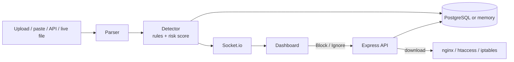

Log Analyzer v2
A website that reads server log files and finds attacks in them. It gives each IP address a risk score and suggests which IPs to block. New alerts show up on the screen live.
Live demo: `PASTE-YOUR-onrender.com-LINK-HERE` (needs a password, contact me for access)

Why I built it
My first version was a C# desktop app called ServerLogApp. It counted 404, 403 and 500 errors in a log file and saved a CSV report. It could only look at old data, and it could not tell a normal mistake from a real attack.
This version is a web app. It finds attack patterns, watches each IP over time, shows alerts live, and lets you export a list of IPs to block.
What it does
Finds attacks: SQL injection, XSS, path traversal, brute-force logins, directory scanning, and attack tools like sqlmap and nikto.
Watches behavior over time: for example, 10 failed logins from one IP in 60 seconds is flagged. One wrong password is not.
Reads encoded attacks: it decodes URLs first, so `%27%20OR%201%3D1--` is caught the same as `' OR 1=1--`.
Risk score from 0 to 100: you can click Block or Ignore for each IP. The score keeps going up if the attack continues.
Exports a blocklist for nginx, `.htaccess`, iptables, or as a plain list.
Live dashboard: alert pop-ups, charts for requests and alerts per minute, attack types, and an alert feed.
Settings you can change in the page (the limits for brute force and scanning).
Four ways to add logs: upload a file, paste lines, send lines with an API call, or follow a live log file.
Saves data in PostgreSQL. If there is no database, it keeps data in memory instead.
Password protection for public websites (turn it on with one setting).
Screenshots
IP risk and blocklist	Live alerts
	
How it finds attacks
Attack	What it looks for	Severity
SQL injection	Patterns like `UNION SELECT`, `' OR 1=1`, `sleep()`, `information_schema` in the URL	Critical
XSS	`<script`, `onerror=`, `javascript:`	High
Path traversal	`../`, `/etc/passwd`, `win.ini`	High
Brute force	10 or more failed logins from one IP in 60 seconds	High
Directory scanning	15 or more 404 errors from one IP in 60 seconds	Medium
Attack tool	A known tool name in the user agent (sqlmap, nikto, etc.)	Medium
You can change the limits for brute force and scanning. Each alert adds points to the IP's score (maximum 100). An IP with 50 points or more is suggested for blocking.
How it works

Project files:
```
server.js            Web server, live updates, log file follower
src/parser.js        Reads log lines and decodes URLs
src/detector.js      Attack rules and risk scores
src/blocklist.js     Makes the blocklist files
src/auth.js          Optional password protection
src/db.js            PostgreSQL, or memory if there is no database
src/sampleLog.js     Makes fake attack traffic for demos and tests
public/              The dashboard (index.html and app.js)
tests/               Automatic tests
schema.sql           PostgreSQL tables (the app also creates them by itself)
```
Tech used
Node.js, Express, Socket.io, PostgreSQL, plain JavaScript, SVG charts, Node's built-in test runner. Hosted on Render.
Run it on your computer
```bash
git clone https://github.com/YOUR-USERNAME/log-analyzer-v2.git
cd log-analyzer-v2
npm install
npm run gen-logs     # makes samples/access.log with fake attacks
npm start            # open http://localhost:5000
npm test
```
Optional settings (environment variables):
Name	What it does
`PORT`	Port number (default 5000)
`DASHBOARD_PASSWORD`	Turns on the login. The user name is `admin` (change it with `DASHBOARD_USER`)
`DATABASE_URL`	PostgreSQL connection string (for example from Neon). The app creates its tables by itself. Without it, data stays in memory
`LOG_FILE`	A live log file to follow, like `/var/log/nginx/access.log`
Send one log line from the command line:
```bash
curl -X POST localhost:5000/api/ingest -H "Content-Type: application/json" \
  -d '{"line":"1.2.3.4 - - [30/Oct/2026:12:00:00 +0000] \"GET /?id=1%27%20OR%201=1-- HTTP/1.1\" 200 512 \"-\" \"curl\""}'
```
API
Method	Path	What it does
GET	`/api/state`	Get the current dashboard data
POST	`/api/upload`	Analyze a log file (field name `logfile`)
POST	`/api/ingest`	Send one or more log lines
POST	`/api/simulate`	Play fake attack traffic live
POST	`/api/reset`	Clear the current data
GET / PUT	`/api/config`	Read or change the limits
POST	`/api/blocklist/:ip`	Set `approved`, `rejected` or `clear` for an IP
GET	`/api/blocklist/export?format=`	Download the blocklist (`nginx`, `htaccess`, `iptables`, `txt`)
GET	`/api/alerts/export`	Download alerts as a CSV file
GET	`/api/history`	Get recent saved analyses
Tests and results
`npm test` runs 12 tests. They check the parser, each attack rule, encoded attacks, the limits, the risk score, and the blocklist files.
I also tested with a fake log of 412 requests: 300 from 20 normal visitors and the rest from 5 fake attackers. The app found all 5 attackers and did not flag any normal visitor. I made this data myself, so it shows the rules work as I designed them. It does not show how well they work on real traffic.
Safety
Log lines can contain attacks, so everything is escaped before it is shown on the page.
Every IP is checked before it goes into a blocklist file, so a fake log line cannot add commands to the file.
The password check is built to resist timing attacks.
Uploaded files can be 50 MB at most.
Limits and next steps
The rules use patterns and counters. They are a helper, not a full firewall, and a skilled attacker can get around them. A normal request can sometimes be flagged by mistake.
There is one shared password. Next, I want to add user accounts with JWT and roles.
Ideas for later: a map of where attacks come from, email alerts, Docker, and machine learning to find strange traffic.
